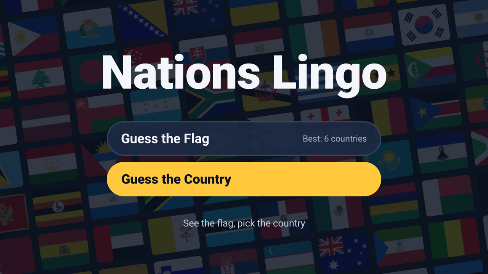
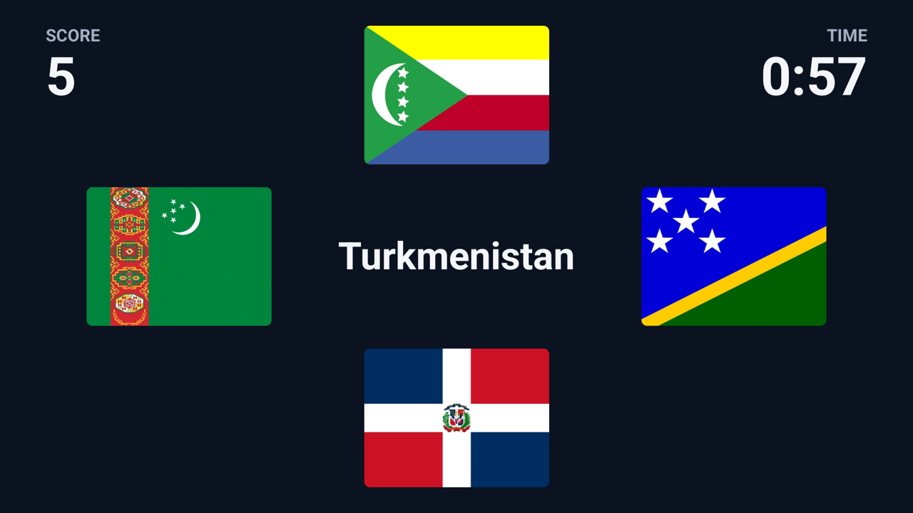
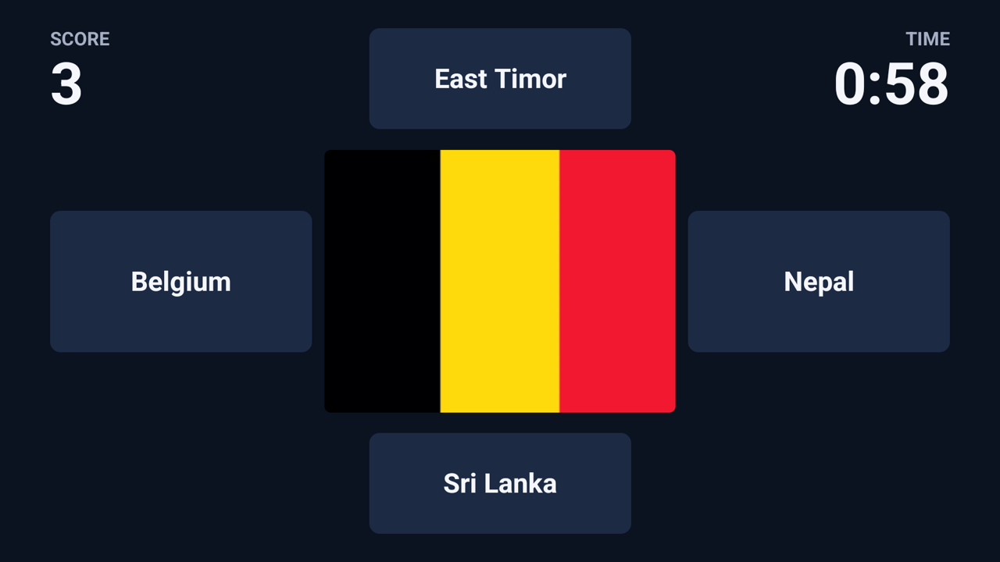
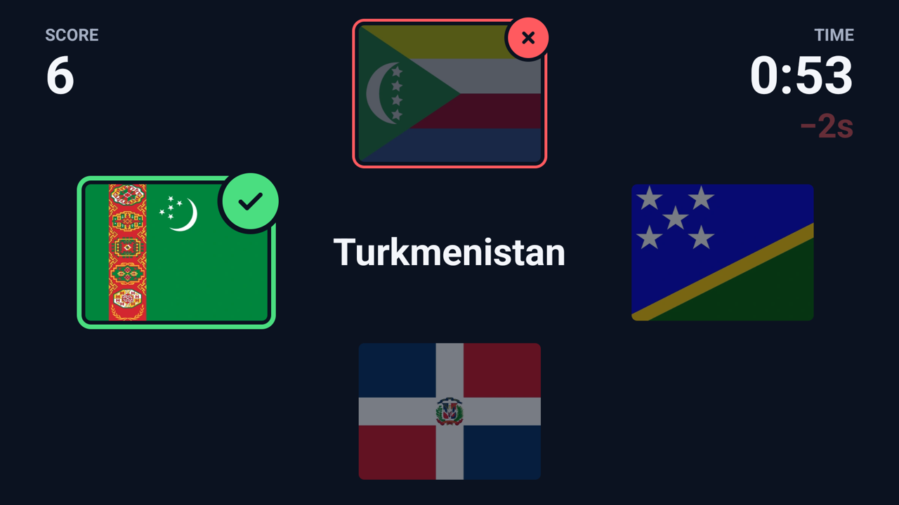
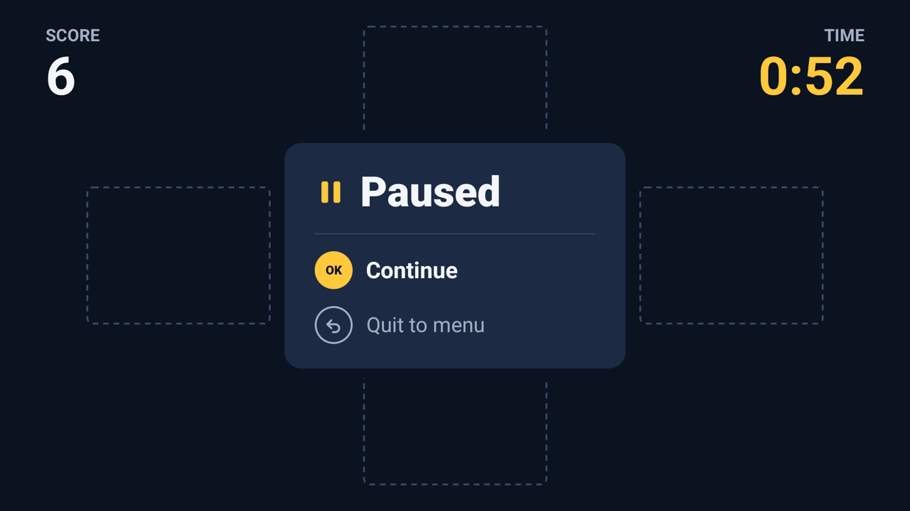
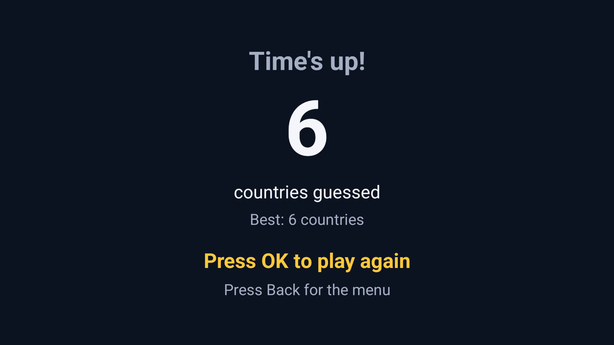
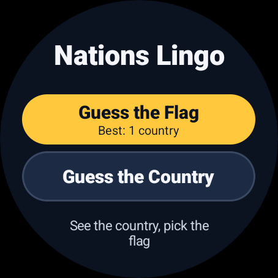
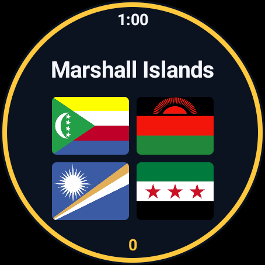
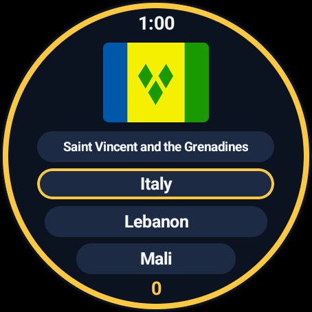

# Nations Lingo

**How many of the world's 197 flags can you name in a minute?**

Nations Lingo is a flag quiz for Android TV and Wear OS watches. Grab the remote (or your wrist), pick a
game, and choose the right answer as fast as you can. Every right answer on the first try buys you two more seconds, so a good run can go on
for a long time.

No account, no ads, no internet needed.



## Two games

**Guess the Flag** shows a country's name in the middle of the screen, with four flags around it. Press the
D-pad towards the flag that belongs to that country.



**Guess the Country** turns it around: one flag in the middle, four country names around it.



Each game keeps its own best score.

## How to play

| Button on the remote | What it does |
| --- | --- |
| Up, down, left, right | Pick the answer on that side. On the title screen, choose a game. |
| OK | Start a game, or carry on after a pause. |
| Back | Pause. From the pause screen, go back to the menu. |

- You start with **1 minute** on the clock.
- **Right answer:** 1 point. If it was your first try on that country, you also get **+2 seconds**.
- **Wrong answer:** **−2 seconds**, and the country stays until you find it. Pressing the same wrong
  answer again costs nothing.
- The game ends when the clock runs out, or when you've named all 197 countries.

A right answer gets a green check and a wrong one a red cross, so you can see what happened before the next
country comes up.



Pressing Back, or going to the TV's home screen, pauses the game. The flags and names are hidden while the
game is paused, so there's no studying the answers while the clock is stopped.



When time runs out you'll see your score, and whether you beat your record.



## On your watch

The same two games, with the same rules and countries, fit on a Wear OS watch. Tap the right answer, or turn
the crown to move the yellow outline through the answers and press a side button to pick it.

| On the watch | What it does |
| --- | --- |
| Tap | Pick that answer. On the title screen, start that game. |
| Turn the crown or bezel | Move through the answers. On the title screen, choose a game. |
| Side button | Pick the outlined answer, start a game, or carry on after a pause. |
| Swipe right | Pause. From the pause screen, go back to the menu. |

Wear OS keeps the crown's own press for the system (it goes to the app list), so a press of the crown can't
pick an answer; the side buttons that apps are allowed to use do. Letting the watch screen go dark pauses the
game too.

<p>
  
  
  
</p>

## Countries and languages

All 193 members of the United Nations are in the game, plus Palestine, the Vatican, Kosovo and Taiwan.
Flags that are almost impossible to tell apart, like Chad and Romania, never show up in the same round.

The game follows your TV's or watch's language:

| Language | The game is called |
| --- | --- |
| English (and any language not listed below) | Nations Lingo |
| Portuguese (from Portugal) | Lingo das Nações |
| Spanish | Lingo de las Naciones |
| French | Lingue des Nations |
| German | Nationen-Lingo |

## Install it on your TV

Nations Lingo isn't in the Play Store. Download the APK from the
[latest release](https://github.com/jjmluz/nations-lingo/releases/latest) and sideload it onto any Android TV
or Google TV running Android 8 or later. Newer releases install over older ones and keep your best scores.

There are two common ways to sideload:

- **From the TV:** install a file manager or downloader app on the TV, open the APK with it, and allow it to
  install unknown apps when asked.
- **From a computer with `adb`:** turn on
  [developer options and USB or network debugging](https://developer.android.com/studio/debug/dev-options)
  on the TV, install the [Android SDK platform tools](https://developer.android.com/tools/releases/platform-tools),
  and run:

  ```bash
  adb connect <tv-ip-address>:5555
  adb install -r nations-lingo-<version>.apk
  ```

The game then shows up with your other apps on the TV's home screen.

## Install it on your watch

Download `nations-lingo-wear-<version>.apk` from the same release. It runs on watches with Wear OS 3 or
later, and doesn't need a phone. Turn on
[ADB debugging over Wi-Fi](https://developer.android.com/training/wearables/get-started/debugging) on the
watch, then pair and install from a computer:

```bash
adb pair <watch-ip-address>:<pairing-port>
adb connect <watch-ip-address>:<port>
adb install -r nations-lingo-wear-<version>.apk
```

## For developers

Kotlin and Jetpack Compose, in three modules:

- `shared`: the rules, the countries and flags, the sounds, all the text, and the view model that runs a game.
- `app`: the Android TV app, played with the remote.
- `wear`: the Wear OS app, played by touch and with the crown.

Both apps have the same package name, as one app for two kinds of device. Building needs Android Studio's
JDK (21) and the Android SDK; `local.properties` holds the SDK path.

```bash
export JAVA_HOME="/Applications/Android Studio.app/Contents/jbr/Contents/Home"
./gradlew lintDebug testDebugUnitTest assembleRelease
adb install -r app/build/outputs/apk/release/app-release.apk    # on a TV
adb install -r wear/build/outputs/apk/release/wear-release.apk  # on a watch
```

A release build you make yourself is signed with your own debug key, so it can't update a copy installed
from GitHub (or the other way round). Uninstall one before installing the other. If several devices are
connected, pick one with `ANDROID_SERIAL` (see `adb devices`).

### CI and releases

GitHub Actions (`.github/workflows/ci.yml`) runs lint, the unit tests and a release build on every push to
`main` and every pull request. To publish a release, push a tag:

```bash
git tag v1.5.0
git push origin v1.5.0
```

CI then builds `nations-lingo-1.5.0.apk` for TV and `nations-lingo-wear-1.5.0.apk` for watches, signs them
with the release key, and attaches them to a new GitHub release with generated notes. The version name comes from the tag and the version code from the CI run
number.

### Where things are

- `shared/…/Game.kt`: the rules, with no Android code. Tested in `GameTest.kt`.
- `shared/…/GameViewModel.kt`: runs a game on the real clock and saves the best score of each game.
- `shared/…/Sounds.kt`: plays the sound effects.
- `shared/…/Countries.kt`: the 197 countries. Their names in each language are in
  `shared/src/main/res/values*/countries.xml`, and the rest of the text in `strings.xml`.
- `app/…/MainActivity.kt` and `Screens.kt`: the TV app, which maps remote keys to the game.
- `wear/…/MainActivity.kt`, `Crown.kt` and `WearScreens.kt`: the watch app, laid out for a round screen.
  `Crown.kt` is the crown's highlight, tested in `CrownTest.kt`.

### Flags

Flags come from [flag-icons](https://github.com/lipis/flag-icons) (MIT). They are rendered to
`shared/src/main/res/drawable-nodpi` by `tools/generate_flags.cjs`, which also makes the launcher icon (for
both apps) and the TV banner, and
lists flags that look alike. Pairs too close to tell apart go in `LOOKALIKES` in `Game.kt`.

### Sounds

The sound effects are synthesized by `tools/generate_sounds.py` into `shared/src/main/res/raw`.

### Screenshots

The pictures in this README are in `docs/screenshots`, taken on the `GoogleTV_34` emulator at 1080p and
scaled to 1280 pixels wide. The watch ones, in `docs/screenshots/wear`, come from the `Wear_OS_Large_Round`
emulator.

## License

Nations Lingo is released under the [MIT License](LICENSE). The flags come from
[flag-icons](https://github.com/lipis/flag-icons), also under the MIT License.
